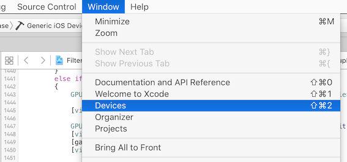
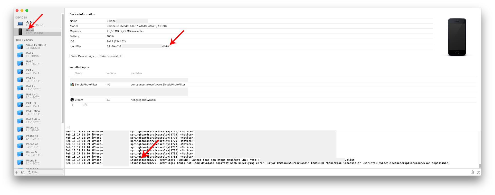

# Getting more information with xcode's console on iOS

Apple doesn't provide much information to the end user when the installation goes wrong. Often, error messages are generic ones like "The application could not be downloaded".

One way to get a little bit more information is to connect the device to a Mac with xcode, and look at the console.

## Accessing the console

The device console is located in Xcode's __Window > Devices and Simulators__ menu. Select your device on the left, then click __Open Console__ to view the device logs.

> In older versions of Xcode (before Xcode 11), the menu was called __Window > Devices__ and the console appeared directly in the bottom right of the Devices window.

Start the installation on the device through the Diawi link.

Search the logs for lines containing `itunesstored` or `appstored` or words like `installation` or `error`: those error messages often help debugging problems with installations.

If you don't find the error message, copy and paste all the logs and provide them inside a support ticket: we'll help you get the information! 
